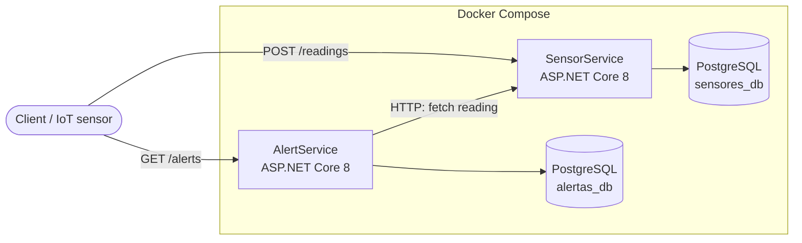

# 🌱 Environmental Monitoring Platform

Microservices platform that collects environmental sensor readings (air quality, temperature) and automatically raises alerts when values cross safe thresholds. Built with **ASP.NET Core 8**, a **PostgreSQL database per service**, **Docker Compose** and **GitHub Actions**.

University extension project — Computer Engineering, Universidade Veiga de Almeida (UVA). Aligned with UN Sustainable Development Goals 13 (Climate Action), 11 (Sustainable Cities) and 3 (Health). 🇧🇷 [Versão em português](README.pt-BR.md)


## Architecture



Each service owns its data (**database per service**) and they talk only over HTTP/REST. In Docker Compose, each database lives on its own internal network, reachable only by the service that owns it.

| Service | Responsibility |
| --- | --- |
| **SensorService** | Source of truth for readings: stores and serves sensor data. Knows nothing about alerts. |
| **AlertService** | Evaluates readings against thresholds and stores the alerts. Fetches readings from SensorService when needed. |

## Current status

**Done — infrastructure**

- [x] Solution with two independent ASP.NET Core 8 services
- [x] Multi-stage Dockerfile for each service
- [x] Docker Compose with one PostgreSQL 16 per service, health checks and isolated networks
- [x] GitHub Actions: restore, build, Compose validation and Docker image build for both services

**Next — domain and API**

- [ ] SensorService: `Reading` model, EF Core + migrations, endpoints below
- [ ] AlertService: `Alert` model, EF Core + migrations, threshold rules, endpoints below
- [ ] HTTP client from AlertService to SensorService (typed `HttpClient` with retry)
- [ ] Unit tests for the alert rules and integration tests for the endpoints, running in CI
- [ ] JWT authentication on write endpoints

## API (planned)

**SensorService** — `http://localhost:5001`

| Method | Route | Description |
| --- | --- | --- |
| `GET` | `/health` | Service health check |
| `GET` | `/readings?type=&sensorId=` | List readings, with optional filters |
| `GET` | `/readings/{id}` | Get one reading |
| `POST` | `/readings` | Register a reading |

**AlertService** — `http://localhost:5002`

| Method | Route | Description |
| --- | --- | --- |
| `GET` | `/health` | Service health check |
| `GET` | `/alerts` | List generated alerts |
| `POST` | `/alerts` | Evaluate a reading sent in the body |
| `POST` | `/alerts/evaluate/{readingId}` | Fetch the reading from SensorService and evaluate it (service-to-service call) |

**Alert rules**

| Reading type | Threshold | Severity |
| --- | --- | --- |
| `air_quality` | > 100 AQI | high |
| `temperature` | > 35 °C | medium |

Example reading:

```json
{
  "sensorId": "sensor-01",
  "type": "air_quality",
  "value": 132.5,
  "unit": "AQI",
  "location": "Maricá - RJ"
}
```

## Running locally

Requirements: Docker with Docker Compose. Optional: .NET 8 SDK to run a service outside Docker.

```bash
git clone https://github.com/PedroArnaldo/Environmental-Monitoring-Platform.git
cd Environmental-Monitoring-Platform
docker compose up --build
```

Run a single service without Docker:

```bash
cd src/SensorService
dotnet run
```

## Security and LGPD (design)

- The platform handles environmental data, which is not personal data; personal data is limited to operator credentials (data minimization).
- Secrets come from environment variables, never from source code.
- Write endpoints protected by JWT; passwords stored as hashes.
- HTTPS in production and access logs without sensitive data.

## Project structure

```
.
├── .github/workflows/ci.yml
├── docker-compose.yml
└── src/
    ├── MonitoringPlatform.sln
    ├── SensorService/   # ASP.NET Core 8 + Dockerfile
    └── AlertService/    # ASP.NET Core 8 + Dockerfile
```

## Author

**Pedro Arnaldo Madeira Lopes** — Computer Engineering, UVA · [LinkedIn](https://www.linkedin.com/in/pedro-arnaldo-madeira-lopes/) · [GitHub](https://github.com/PedroArnaldo)
